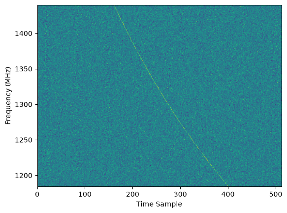
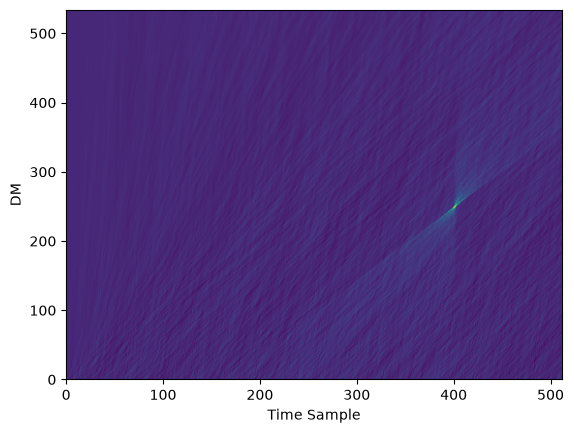
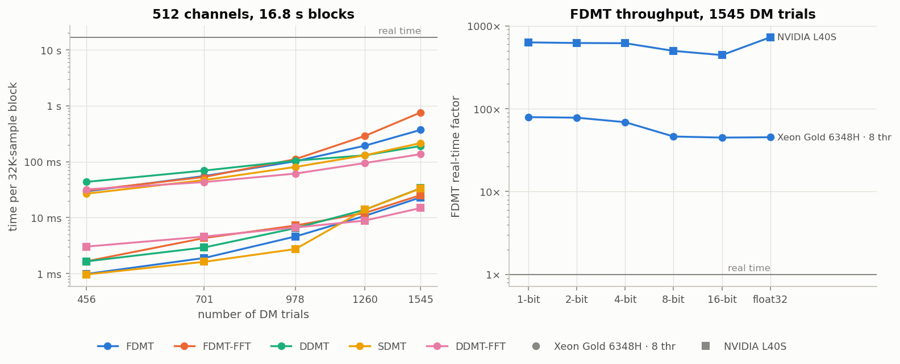

<p align="center">
  <picture>
    <source media="(prefers-color-scheme: dark)" srcset="docs/_static/logo/dmt-logo-tagline-dark.svg">
    
  </picture>
</p>

<div align="center">

[](https://dmt.readthedocs.io/en/latest/?badge=latest)
[](https://github.com/pravirkr/dmt/actions/workflows/ci.yml)
[](https://codecov.io/gh/pravirkr/dmt)
[](pyproject.toml)
[](include/dmt)
[](https://developer.nvidia.com/cuda-zone)
[](LICENSE)

</div>

**`dmt`** is a high-performance C++20 library with Python bindings for dedispersing radio data. It provides the fast tree transforms **FDMT** and **FDMT-FFT**, direct dedispersion with **DDMT**, **SDMT** and **DDMT-FFT**, and **CohFDMT**, a coherent search of baseband voltages. Every engine runs on CPUs and on NVIDIA and AMD GPUs, streams block by block, and reports the exact noise of every DM trial.

**[Documentation](https://dmt.readthedocs.io)** ·
[Getting started](https://dmt.readthedocs.io/en/latest/getting_started/index.html) ·
[Tutorials](https://dmt.readthedocs.io/en/latest/tutorials/index.html) ·
[Benchmarks](https://dmt.readthedocs.io/en/latest/benchmarks.html)

| Dispersed waterfall $I(\nu, t)$ | DM–time plane after FDMT |
| :---: | :---: |
|  |  |

## ✨ Highlights

- **One interface, many engines.** Tree, direct and Fourier-domain
  dedispersion share the same plans, DM grids and conventions, so you can
  swap engines and compare them on the same data.
- **CPU and GPU.** OpenMP and SIMD (AVX2, AVX-512, NEON) on the CPU; CUDA and
  HIP on the GPU, with the same results to float rounding.
- **Built for streaming.** Blocks join exactly through an internal history,
  and several beams can share one plan per call.
- **Low-bit input.** Packed 1–16 bit samples are read directly, without
  converting to float first.
- **Calibrated noise.** Every plan gives the exact sigma of each DM trial,
  so S/N needs no calibration run.
- **Plain time series too.** `dmtlib.dedisperse` returns white-noise
  dedispersed time series for periodicity searches.

## ⚡ Quickstart

### Python

```python
import numpy as np
from dmtlib import compute_fdmt
from dmtlib.simulate import generate_frb

# A dispersed burst (DM 150) in a 256-channel, 1 ms filterbank.
waterfall = generate_frb(
    f_min=1200.0, f_max=1600.0, nchans=256, nsamps=1024, tsamp=1e-3,
    dm=150.0, amp=3.0, offset=200, noise_rms=1.0,
)

# Dedisperse over delays of 0-256 samples across the band (DM 0-203).
dmt, plan = compute_fdmt(
    waterfall, f_min=1200.0, f_max=1600.0, nchans=256, nsamps=1024,
    tsamp=1e-3, dt_max=256, mode="valid",
)

dmt_plane = dmt.reshape(plan.dmt_ndms, plan.dmt_nsamps)
i_dm, t = np.unravel_index(np.argmax(dmt_plane), dmt_plane.shape)
print(f"Burst at DM {plan.dm_grid_final[i_dm]:.1f} pc cm^-3, sample {t}")
```

For a dedispersed time series to Fourier transform, one call keeps the noise
white and drops the startup samples
([periodicity guide](https://dmt.readthedocs.io/en/latest/pipeline_guide/periodicity.html)):

```python
import dmtlib

dms = np.arange(0.0, 200.0, 1.0)
r = dmtlib.dedisperse(waterfall, 1200.0, 1600.0, 1e-3, dms, engine="fdmt_fft")
r.data  # (n_dm, n_out) time series; r.dms, r.f_ref, r.arrival_times()
```

Waterfalls are `(nchans, nsamps)` in **ascending** frequency (row 0 is the
lowest channel) with `f_min`/`f_max` the band edges. Output times refer to
`f_min` by default; DDMT, SDMT and DDMT-FFT also accept `f_ref=f_max` (for
time series that start at the file's first sample). For SIGPROC data (`foff < 0`), use
`dmtlib.sigproc_band(fch1, foff, nchans)` and `dmtlib.to_ascending()`.

### C++

```cpp
#include <dmt/dmt.hpp>

#include <iostream>
#include <span>
#include <vector>

int main() {
    dmt::algorithms::FDMT fdmt(
        /*f_min=*/1200.0F, /*f_max=*/1600.0F, /*nchans=*/256, /*nsamps=*/1024,
        /*tsamp=*/1e-3F, /*dt_max=*/256, /*dt_min=*/0, /*dt_step=*/1,
        /*use_box_smearing=*/true, /*mode=*/"valid",
        dmt::Exec::cpu(/*nthreads=*/4)  // or dmt::Exec::cuda(0), dmt::Exec::hip(0)
    );

    const auto& plan = fdmt.get_plan();
    std::vector<float> waterfall(256 * 1024, 0.0F);
    std::vector<float> dmt_out(plan.get_dmt_size());  // (ndms, dmt_nsamps), row-major

    fdmt.execute(std::span<const float>(waterfall), std::span<float>(dmt_out));
    std::cout << "Dedispersed " << plan.get_dmt_ndms() << " DM trials\n";
}
```

## 📦 Installation

```bash
git clone https://github.com/pravirkr/dmt.git
cd dmt
pip install .          # or: uv pip install .
```

The build picks up a GPU toolchain if it finds one (CUDA first, then ROCm).
To require one, pass `CMAKE_ARGS="-DDMT_GPU=CUDA"` (or `HIP`).

As a C++ library:

```bash
cmake -S . -B build -DCMAKE_BUILD_TYPE=Release
cmake --build build -j
cmake --install build
```

```cmake
find_package(dmt REQUIRED)
target_link_libraries(my_pipeline PRIVATE dmt::dmt)
```

Requirements, CMake options and development installs are in the
[installation guide](https://dmt.readthedocs.io/en/latest/getting_started/installation.html).

## 📊 Benchmarks

Measured with dmt 0.7.0 on an Intel Xeon Gold 6348H (8 threads) and an
NVIDIA L40S (device-resident data). The `cryopaf` preset is 512 channels at
704–1216 MHz and 512 µs, processed as a stream of 16.8 s blocks, with up to
1545 DM trials from 0 to 2000 pc cm⁻³.

<picture>
  <source media="(prefers-color-scheme: dark)" srcset="bench/results/plots/dark/readme_highlight.png">
  
</picture>

Every engine runs faster than real time on both machines: FDMT at 45× real
time on the Xeon and 729× on the L40S, and DDMT-FFT, the fastest engine on
this preset, at 124× and 1130×. Sweeps over DM range, block length and input
width, a second L-band preset, and CohFDMT are on the
[Benchmarks](https://dmt.readthedocs.io/en/latest/benchmarks.html) page;
[`bench/README.md`](bench/README.md) shows how to reproduce them.

## 📜 Citing

If you use `dmt` in your research, please cite the library and the FDMT paper:

```bibtex
@software{kumar2026dmt,
  author = {Kumar, Pravir and Zackay, Barak},
  title  = {{dmt: Fast Dispersion Measure Transform Library}},
  url    = {https://github.com/pravirkr/dmt},
  year   = {2026}
}

@ARTICLE{2017ApJ...835...11Z,
  author  = {{Zackay}, Barak and {Ofek}, Eran O.},
  title   = "{An Accurate and Efficient Algorithm for Detection of Radio Bursts
             with an Unknown Dispersion Measure, for Single-dish Telescopes and
             Interferometers}",
  journal = {\apj},
  year    = 2017,
  volume  = {835},
  number  = {1},
  eid     = {11},
  pages   = {11},
  doi     = {10.3847/1538-4357/835/1/11},
  eprint  = {1411.5373},
  adsurl  = {https://ui.adsabs.harvard.edu/abs/2017ApJ...835...11Z}
}
```

The algorithms build on:

- **FDMT, FDMT-FFT, CohFDMT:** Zackay & Ofek (2017), *ApJ*, 835, 11
  ([arXiv:1411.5373](https://arxiv.org/abs/1411.5373))
- **DDMT:** Barsdell et al. (2012), *MNRAS*, 422, 379
  ([doi:10.1111/j.1365-2966.2012.20622.x](https://doi.org/10.1111/j.1365-2966.2012.20622.x))
- **SDMT:** Naidu et al. (2024), AT-RASC 2024
  ([doi:10.46620/ursiatrasc24/hbrq1825](http://dx.doi.org/10.46620/ursiatrasc24/hbrq1825))
- **DDMT-FFT:** Bassa et al. (2022), *A&A*, 657, A46 (Fourier-domain
  dedispersion); NUFFT kernel from Barnett, Magland & af Klinteberg (2019),
  *SIAM J. Sci. Comput.*, 41, C479

## 📄 License

MIT. See [LICENSE](LICENSE).
